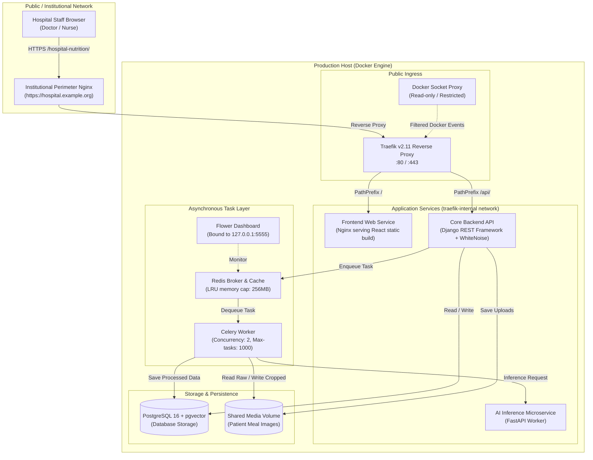

# Hospital Nutrition System — Production DevOps & Infrastructure

[](https://www.docker.com/)
[](https://traefik.io/)
[](https://github.com/features/actions)
[](https://www.postgresql.org/)
[](https://redis.io/)
[](https://docs.celeryq.dev/)
[](#security-docker-daemon-protection)

> **Context & Scope:**  
> This repository showcases the production infrastructure, container orchestration, reverse proxy routing, and CI/CD automation of a **Clinical Hospital Nutrition & Meal Analysis Platform**.  
> The system is currently deployed and running in a live production environment on university hospital infrastructure.  
> 
> *My Role:* I owned and implemented the entire **backend architecture, database schemas, asynchronous processing pipelines, container infrastructure, security hardening, and deployment automation** (the frontend React SPA was developed by another team member).  
> 
> *Notice on Privacy:* Proprietary clinical models, patient schemas, and institutional credentials have been omitted. This repository serves as an open architecture reference and DevOps case study.

---

## 🏗️ High-Level System Architecture

The platform runs as an isolated multi-container stack orchestrated via Docker Compose. Traffic arrives through an institutional perimeter reverse proxy, gets routed via Traefik to internal application services, while heavy compute tasks (computer vision and nutrition estimation) are offloaded to background workers.



---

## 🛠️ Tech Stack & Engineering Decisions

| Layer | Technology | Engineering Rationale |
| :--- | :--- | :--- |
| **Edge Routing** | Traefik v2.11 | Replaced manual Nginx config updates with dynamic container label discovery; services declare their own routing rules. |
| **Daemon Security** | `tecnativa/docker-socket-proxy` | Eliminates the severe security risk of mounting `/var/run/docker.sock` directly into Traefik with root privileges. |
| **Core API** | Django 5.x / DRF | Structured ORM, robust migration engine, and session/token management suitable for clinical audits. |
| **AI Inference** | FastAPI | Lightweight, high-throughput async runtime dedicated to image processing and model inference. |
| **Async Processing** | Celery + Redis | Decouples heavy AI meal analysis from web requests, preventing user-facing HTTP request timeouts. |
| **Relational Data** | PostgreSQL 16 + `pgvector` | Acid-compliant clinical storage with vector extension ready for meal similarity embeddings. |
| **Deployment & CI** | GitHub Actions + Portainer | Automated migration checks on PRs, with webhook-driven deployment triggered only upon approval in protected environments. |

---

## 💡 Key DevOps Challenges & Solutions

### 1. The Subdirectory (Path-Based) Routing Dilemma
- **Problem:** Due to university IT constraints, the application could not have its own subdomain (e.g. `nutrition.hospital.ac.th`). It had to be served under an existing institutional domain at `/hospital-nutrition/`.
- **The Pitfall:** Modern single-page apps and API frameworks make root-relative assumptions (`/assets/...`, `/api/...`, `/media/...`). When placed under a subdirectory, browsers automatically drop the subpath prefix on root-relative links, causing total 404 failures.
- **The Fix:** Configured a synchronized 4-layer prefix coordination:
  1. *Perimeter Nginx:* Stripped prefixes for API and web catch-all, but preserved prefixes for media/static URLs.
  2. *Traefik Middleware:* Used `stripprefix` middleware dynamically based on container labels.
  3. *Frontend (Vite):* Injected `base: '/hospital-nutrition/'` and React Router `basename`.
  4. *Django Settings:* Enforced `FORCE_SCRIPT_NAME = URL_PREFIX`, custom `STORAGES` WhiteNoise config, and explicit `path` scoping on HttpOnly JWT refresh cookies.
- 📖 *Read the complete breakdown:* [Case Study: Subdirectory Routing](docs/subdirectory-routing-case-study.md)

### 2. Docker Daemon Hardening (Docker Socket Proxy)
- **Problem:** Traefik requires access to the Docker API to read container labels. Mounting `/var/run/docker.sock` directly gives the container effective root access over the host machine—if Traefik is compromised, the entire host is compromised.
- **The Fix:** Placed `tecnativa/docker-socket-proxy` in front of the daemon. It exposes an unauthenticated HTTP proxy on an internal bridge network, strictly allowing only safe read endpoints (`CONTAINERS=1`, `EVENTS=1`, `PING=1`, `VERSION=1`) while completely denying `POST`, `DELETE`, and exec calls.
- 📖 *Read the deep-dive:* [Docker Daemon Security Architecture](docs/docker-daemon-security.md)

### 3. Worker Memory Leak Mitigation
- **Problem:** Image analysis libraries (Pillow, OpenCV, Keras/YOLO) in long-running Python processes frequently suffer from unmanaged memory retention at the C-extension level, eventually causing OOM kills on limited server RAM.
- **The Fix:** Configured Celery with `--max-tasks-per-child=1000`, forcing worker processes to cleanly terminate and respawn after processing 1,000 tasks, reclaiming all residual memory without downtime.

### 4. CI/CD Migration Safety Net
- **Problem:** Database migrations forgotten during development lead to catastrophic crashes when deployed to production.
- **The Fix:** Integrated `python manage.py makemigrations --check --dry-run` into the GitHub Actions CI pipeline. If a developer alters a Django model without committing a migration file, the CI pipeline fails immediately and blocks the pull request.

---

## 📁 Repository Structure

```text
hospital-nutrition-showcase/
├── .github/
│   └── workflows/
│       ├── ci.yml                     # CI: Unit tests, linting, and dry-run migration checks
│       └── cd-production.yml          # CD: Environment approvals and Portainer redeploy webhook
├── docs/
│   ├── system-architecture.md         # Full architectural breakdown and network topologies
│   ├── subdirectory-routing-case-study.md # Technical post-mortem on path-based routing
│   ├── docker-daemon-security.md      # Daemon isolation using docker-socket-proxy
│   └── RESUME_AND_LINKEDIN_POINTS.md  # Portfolio bullet points ready for CV / LinkedIn
├── docker-compose.prod.yml            # Production compose with healthchecks & labels
├── docker-compose.dev.yml             # Local development compose
├── .env.example                       # Documented environment variables template
├── .gitignore
└── README.md                          # Main project presentation
```

---

## 🚀 Deployment & Operational Guide

### Prerequisites
- Docker Engine 24+ & Docker Compose v2+
- Port 80 / 443 available on the host machine

### 1. Environment Configuration
Copy the sample environment file and populate values:
```bash
cp .env.example .env
```
Generate secure keys:
```bash
# Generate Django SECRET_KEY
python -c "import secrets; print(secrets.token_urlsafe(50))"

# Generate Fernet Cryptography Key (if using encrypted patient fields)
python -c "from cryptography.fernet import Fernet; print(Fernet.generate_key().decode())"
```

### 2. Booting Production Stack
```bash
# Validate compose syntax
docker compose -f docker-compose.prod.yml config

# Start all services detached
docker compose -f docker-compose.prod.yml up -d --build
```

### 3. Verifying Health & Routing
Check the running services and their health status:
```bash
docker compose -f docker-compose.prod.yml ps
```
All critical services (`db`, `redis`) feature active healthchecks:
- Database: `pg_isready -U ${POSTGRES_USER} -d ${POSTGRES_DB}`
- Redis: `redis-cli ping`
- Downstream application containers wait for healthy upstream conditions before launching (`condition: service_healthy`).

Access Flower task monitor (accessible only locally on the host for security):
```bash
# Forward port via SSH if accessing remotely:
ssh -L 5555:localhost:5555 user@server-ip
# Open http://localhost:5555 in your local browser
```

---

## 👤 Author & Background

**Sarunrat (DevOps & Backend Engineer)**  
- Primary Focus: Container Orchestration, CI/CD Automation, Backend Infrastructure, Linux Server Administration.  
- Passionate about building robust, secure, and production-tested software systems.
