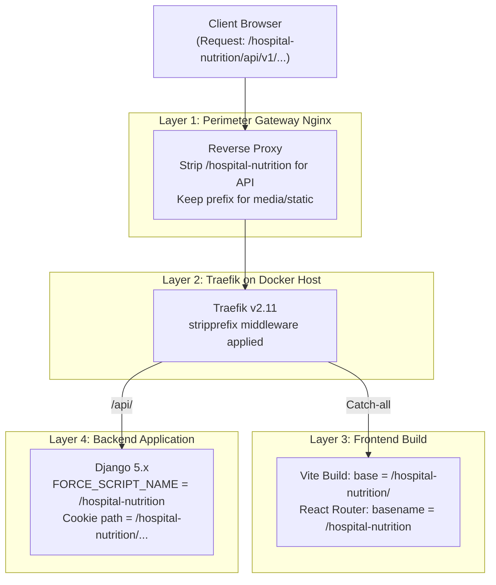

# Case Study: Solving Path-Based Subdirectory Routing Across Multi-Tier Reverse Proxies

**Status:** Deployed & Verified in Production  
**Target URL:** `https://hospital.example.org/hospital-nutrition/`  
**Internal Stack:** Nginx (Institutional Gateway) -> Traefik v2.11 (Host Proxy) -> Docker Compose Services

---

## 1. The Context & The Dilemma

When deploying web applications in enterprise, university, or healthcare settings, infrastructure engineers rarely have the freedom to allocate custom top-level domains or subdomains (e.g. `nutrition.hospital.ac.th`) due to institutional governance, shared SSL wildcard limitations, or perimeter firewall rules.

Instead, the requirement was:
> **Map `https://hospital.example.org/hospital-nutrition/` to an internal Docker stack running on a server inside the private network.**

### Why Subdirectory Deployments Are Deceptively Hard
Unlike a subdomain where the application sits at the domain root (`/`), a subdirectory deployment means the application lives at a path prefix.

**The "Root-Relative URL" Trap:**
Modern web browsers know nothing about where an application was meant to live. When a browser loads `https://hospital.example.org/hospital-nutrition/` and sees HTML referencing:
- `<script src="/assets/index-D1.js">`
- ``
- `fetch("/api/v1/auth/login")`

The browser immediately resolves these paths against the **domain root**:
- `https://hospital.example.org/assets/index-D1.js` ❌ (404 Not Found — hits the university main website!)
- `https://hospital.example.org/api/v1/...` ❌ (404 Not Found)

To make the system work, **every single layer of the stack must agree on how this prefix is handled.**



---

## 2. The 4-Tier Architectural Fix

### Tier 1: Institutional Gateway Nginx
The perimeter gateway had to distinguish between endpoints where the internal container expects a prefix vs. where it expects a clean root path:
- **`api/` and frontend catch-all:** Must **strip prefix** before forwarding to the host, because Django `urls.py` and Vite's internal Nginx container listen at `/`, unaware of the institutional subpath.
- **`media/` and `static/`:** Must **preserve prefix**, because Django generates absolute URLs with the prefix embedded for public clients.

### Tier 2: Host Traefik Reverse Proxy
Traefik manages dynamic routing on the host machine. We configured `stripprefix` middleware on container labels so downstream containers receive clean paths:

```yaml
labels:
  - "traefik.enable=true"
  - "traefik.http.routers.api.rule=Host(`${DOMAIN}`) && (PathPrefix(`${VITE_BASE_PATH}api`) || PathPrefix(`${VITE_BASE_PATH}static`))"
  - "traefik.http.middlewares.api-strip.stripprefix.prefixes=${STRIP_PREFIX}"
  - "traefik.http.routers.api.middlewares=api-strip"
```

### Tier 3: Frontend Asset Pipeline (Vite + React Router)
If Vite compiles assets without a base path, `<script src="/assets/main.js">` will be hardcoded in `index.html`. We resolved this at build time:

1. **`vite.config.js`:**
   ```javascript
   export default defineConfig({
     base: process.env.VITE_BASE_PATH || "/",
     plugins: [react()],
   });
   ```
2. **`main.jsx` (React Router):**
   ```jsx
   <BrowserRouter basename={import.meta.env.VITE_BASE_PATH || "/"}>
     <App />
   </BrowserRouter>
   ```

### Tier 4: Django Backend & Cookie Scoping

#### 1. `FORCE_SCRIPT_NAME`
When Django generates reverse URLs (for Swagger UI, OAuth redirects, or hyperlinked REST APIs), it relies on `request.META['SCRIPT_NAME']`. Since Traefik stripped the prefix, Django would generate URLs missing `/hospital-nutrition`.
We resolved this centrally in `settings.py`:
```python
URL_PREFIX = os.environ.get('URL_PREFIX', '')
FORCE_SCRIPT_NAME = URL_PREFIX or None

MEDIA_URL = f'{URL_PREFIX}/media/'
STATIC_URL = f'{URL_PREFIX}/static/'
```

#### 2. HttpOnly Cookie Path Synchronization (Critical Bug Resolved)
The application uses JWT authentication where `refresh_token` is stored in an `httpOnly` cookie.
By default, Django sets cookie `path='/'`. However, because the user accesses the app under `https://hospital.example.org/hospital-nutrition`, setting `path='/'` could cause cookie conflicts with other applications running on the same domain.
More critically, if the cookie path is set to `/api/v1/auth/` (the path Django sees after stripping), the browser will **refuse to send the cookie** because the browser is visiting `/hospital-nutrition/api/v1/auth/`!

We synchronized cookie path assignment across all auth views:
```python
response.set_cookie(
    key='refresh_token',
    value=str(token),
    httponly=True,
    secure=True,
    samesite='Lax',
    path=f"{settings.URL_PREFIX}/api/v1/authentication/"
)
```

#### 3. WhiteNoise Static Files in Django 5
Django 5 deprecated `STATICFILES_STORAGE` in favor of `STORAGES`. We updated the static asset pipeline to use WhiteNoise with strict static prefix binding:
```python
STORAGES = {
    "default": {"BACKEND": "django.core.files.storage.FileSystemStorage"},
    "staticfiles": {"BACKEND": "whitenoise.storage.CompressedManifestStaticFilesStorage"},
}
WHITENOISE_STATIC_PREFIX = STATIC_URL
WHITENOISE_USE_FINDERS = False
```
And integrated `python manage.py collectstatic --noinput` directly into the `Dockerfile.prod` build step so images are immutable and self-contained.

---

## 3. Real-World War Story: The Traefik Docker API v1.41 Bug

During the initial deployment of Traefik behind `tecnativa/docker-socket-proxy`, all requests immediately returned `404 Not Found ("no matching router")`, even though container labels were formatted properly.

### Investigation & Root Cause:
1. Inspected logs:
   ```bash
   docker logs socket-proxy
   # Output: "GET /v1.41/version HTTP/1.1" 400 Bad Request
   ```
2. In the original compose file, someone had hardcoded `DOCKER_API_VERSION=1.41` on Traefik.
3. API version 1.41 corresponds to Docker Engine circa 2019. The production host was running modern Docker Engine (API v1.44+).
4. The socket proxy rejected the outdated API call with HTTP 400. Because Traefik failed its initial version handshake, it never queried for container labels, silently failing to register any routes.

### Solution:
Removed the hardcoded `DOCKER_API_VERSION` environment variable entirely, allowing Traefik's Docker client to perform standard API version auto-negotiation. Routes populated immediately.

---

## 4. Key Takeaways for DevOps Engineers

1. **Path-based routing is not just a reverse proxy task;** it requires end-to-end synchronization between gateway, edge proxy, frontend bundler, and backend URL/cookie engines.
2. **Never hardcode Docker API versions** unless you have a strict, pinned kernel/engine requirement.
3. **Always build static assets into the image (`collectstatic`)** rather than relying on runtime entrypoint scripts or manual steps.
